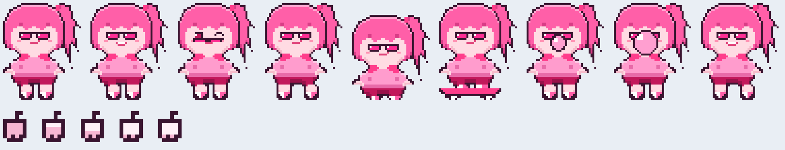

# Desktop Buddies

Tiny pixel-art companions that live on your Windows desktop. They wander
across your screens, climb between monitors, chat and play with each other,
and get out of the way when you go fullscreen.



## Important Note

The project is entirely vibe coded by Claude. 
I wrote exactly zero lines of this project.
Please do not use this project to judge my programming skills. 
All I wrote are the prompts. 
I mostly just specify the structure of the code (to maintain modularity of the characters).
And the relationship between the characters (my head cannon).
## Running it

You need **Windows** and **Python 3** (the standard install from python.org
includes tkinter, which is all it uses - no other packages).

Double-click `desktop_buddy.pyw`, or run:

```
pythonw desktop_buddy.pyw
```

To start them with Windows, put a shortcut to `desktop_buddy.pyw` in your
Startup folder (Win + R, then `shell:startup`).

## Playing with them

| | |
|---|---|
| **Click** | pet them (hearts!) |
| **Drag** | pick them up and throw them. Shake them and they get dizzy |
| **Double-click** | feed them |
| **Right-click** | menu: feed, come here, nap, tricks, add a buddy, send home |

They roam every monitor, climb up to stacked screens, chat, play tag, nap
together and leave things lying around. When a game or video goes
fullscreen, they move to another screen and watch.

## The buddies

| | |
|---|---|
| **Mochi** | a tsundere cat who scratches your screen and knocks things off it |
| **Nova** | a cheerful android who hovers, scans and dances |
| **Echo** | a self-aware robot who is *very* attached to you |
| **Milo** | a nerd in a lab coat who blurts out fun facts (and learns new ones) |
| **Biscuit** | a golden retriever who is best friends with everyone and loves fetch |
| **Roxy** | a hip, cool girl in pink who skates, blows bubblegum and vibes |

Buddies have relationships too - besties, crushes, rivals - and act on them.

## Making your own

Every buddy is a folder in `characters/` with its art, its lines and its
behaviours, so buddies can be shared by sharing a folder. Copy
`template_character/` to start a new one, and see
[CHARACTERS.md](CHARACTERS.md) for everything a character can do.

```
desktop_buddy.pyw        start here
buddyengine.py             the engine
buddyart.py                pixel-art helpers for drawing characters
tools/bake_sprites.py    rebuilds a character's sprites.json from its source.py
characters/              the buddies
template_character/      a starter buddy to copy
```

Only add characters from people you trust: a character's `.py` files run
when the buddies start.

## License

MIT - see [LICENSE](LICENSE). Use it, change it, share it.
